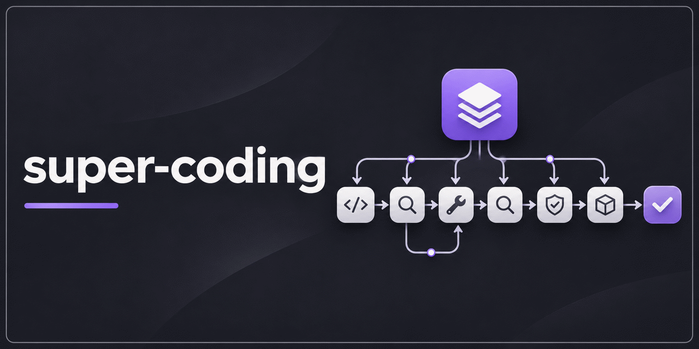
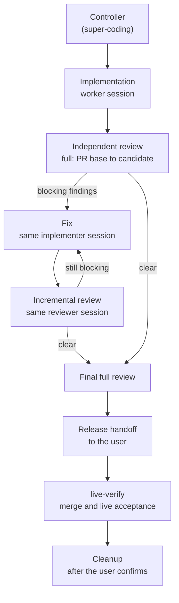

<p align="center">
  
</p>

# super-coding

**English** | [简体中文](README.zh-CN.md)

[](https://github.com/xmxxc/super-coding/actions/workflows/ci.yml)
[](https://github.com/xmxxc/super-coding/releases)
[](LICENSE)

A multi-ticket development workflow for coding agents: one controller dispatches implementation and independent review to Codex, OpenCode or Claude Code sessions, sleeps while they work, and is woken by their messages.

## What it is

super-coding is a set of agent skills. You open one controller session, point it at a repository and a set of tickets, and it runs each ticket from implementation to release handoff:

- Every implementer and reviewer runs in its own host session, dispatched through `wfc`, the dispatcher from [xmxxc/workflow-core](https://github.com/xmxxc/workflow-core).
- Fix rounds go back to the original implementer and incremental reviews to the original reviewer, so each round only covers the new patch.
- A final full review comes before release, and live acceptance is handed to `live-verify`.

It suits work that spans several tickets or several agents, where you want reviews independent of the implementer, a written ledger of every round, and a controller that sleeps while workers are busy.

## Workflow



Review semantics (full, incremental and final), independence rules and record formats are in [references/review.md](skills/super-coding/references/review.md).

## Features

- **Three hosts.** Workers and reviewers can run on Codex, OpenCode or Claude Code; the controller can run on any of the three.
- **Sleep and wake.** On Claude Code the controller keeps a background `wfc wait`; on Codex and OpenCode it starts one `wfc relay`, which delivers worker messages as a new turn.
- **Same-session fixes.** `wfc continue` sends fixes to the original implementer and re-reviews to the original reviewer; the review widens to a full one when the patch's impact is unclear or history was rewritten.
- **Reconcile on every wake.** After handling a message the controller dispatches whatever is ready and only stops when the remaining items need the user (merge, live acceptance, production, reclaim).
- **Routine checks as a script.** `scripts/ctl.py` runs snapshot checks with real exit codes, reads back the candidate, transcribes an offline reviewer's record, and switches lifecycle labels.
- **Ledger, review and release rules in one skill.** The ledger, task files, independent review, verification levels, issue labels and the release handoff are references of `super-coding`, each read at the stage that needs it.
- **Role table.** Hosts, models, reasoning effort, network access and fallbacks per role live in `docs/agents/roles.md`.
- **User-controlled cleanup.** When the scope is done, tmux sessions, worktrees, merged branches, router state and ports are listed for the user; sessions are closed with `wfc reclaim` only after the user agrees.

## Prerequisites

| Requirement | Notes |
| --- | --- |
| Linux or macOS | On Windows, use WSL2. |
| Python 3.9+ | For `install.py` and `scripts/ctl.py` (standard library only). |
| tmux | Every worker runs in a tmux session named `wfc-<dispatch id>`. |
| `wfc` 0.4.4 or later, on `PATH` | Download from the [xmxxc/workflow-core](https://github.com/xmxxc/workflow-core) Releases. |
| `gh` | For GitHub tickets and PRs. |
| Host CLIs | Claude Code, Codex and/or OpenCode, whichever you dispatch to. |

### Skills from mattpocock/skills

At run time these skills call, or rely on, skills from the public [mattpocock/skills](https://github.com/mattpocock/skills) repository.

| Skill | Status | How it is used |
| --- | --- | --- |
| [`setup-matt-pocock-skills`](https://github.com/mattpocock/skills/tree/main/skills/engineering/setup-matt-pocock-skills) | **Bundled.** A pinned, unmodified copy ships in `skills/setup-matt-pocock-skills/`; `install.py` installs it only where you have none of your own. | Called by `super-coding` and `live-verify` when the project is not initialized, that is, when `docs/agents/` lacks the issue tracker, label or domain configuration. Run it once per project first. |
| [`code-review`](https://github.com/mattpocock/skills/tree/main/skills/engineering/code-review), [`implement`](https://github.com/mattpocock/skills/tree/main/skills/engineering/implement), [`tdd`](https://github.com/mattpocock/skills/tree/main/skills/engineering/tdd) | **Recommended, not bundled.** Install separately. | General development skills the workers use. The task files leave the working method to the development workflow installed in the project rather than naming these skills, so install the ones your workers should use. |

## Quick start

1. **Install.** Download `super-coding-<version>.tar.gz` from [Releases](https://github.com/xmxxc/super-coding/releases) and unpack it (or clone this repository), then run:

   ```sh
   python3 install.py
   ```

   It installs `super-coding` into `~/.claude/skills` and `~/.codex/skills` (for each of the two that exists), and installs the bundled `live-verify` and `setup-matt-pocock-skills` only where you have none of your own. When your own copy differs from the bundled one, the installer names the differing files and leaves your copy as it is. A linked development install is left alone. A skill left over from an earlier release that `super-coding` no longer needs is kept, and the installer says you can remove it. Put `wfc` on your `PATH` as well.

2. **Initialize the project.** If `docs/agents/` does not yet describe the issue tracker, labels and domain, run `setup-matt-pocock-skills` (installed in step 1) in the project.

3. **Write the role table.** Copy the template from [skills/super-coding/references/roles.md](skills/super-coding/references/roles.md) to `docs/agents/roles.md` and adapt it. If the table is missing, the controller asks you and writes your answers into it.

4. **Start the controller.** Open a session on your host and invoke `super-coding` with the repository and the tickets in scope. On Codex, start the controller session with `danger-full-access`; on OpenCode, start it on a fixed port (`opencode <dir> --port <port>`). Host-specific commands are in [references/router.md](skills/super-coding/references/router.md).

## Role table example

The controller reads `docs/agents/roles.md` when it takes over. The controller itself is not listed: whichever session invokes `super-coding` is the controller.

```markdown
| Role | Host | Model | Effort | Network | Fallback host | Fallback model |
| --- | --- | --- | --- | --- | --- | --- |
| Implementation | codex | gpt-6.1-sol | high | no | claude | default |
| Frontend implementation | claude | default | default | yes | codex | default |
| Review | codex | gpt-6.1-sol | high | no | claude | default |
```

- **Host**: the value for `wfc dispatch --host` (`codex`, `opencode`, `claude`).
- **Model** / **Effort**: values for `--model` / `--effort`; "default" omits the flag. OpenCode requires an explicit model.
- **Network**: only affects Codex, where "yes" adds `--network`.
- **Fallback host** / **Fallback model**: where to redispatch when the primary host is out of quota or fails authentication; "none" means the user handles it.

The template in the repository is in Chinese; the example above is a translation.

## Repository layout

```text
.
├── docs/assets/banner.png
├── install.py                    # installer
├── skills/
│   ├── super-coding/             # the controller skill
│   │   ├── SKILL.md
│   │   ├── references/
│   │   │   ├── router.md         # dispatch, waiting, continue/resume, messages, recovery
│   │   │   ├── roles.md          # role table template
│   │   │   ├── ledger.md         # ledger, task states, records
│   │   │   ├── handoff.md        # implementation and fix task files
│   │   │   ├── review.md         # independent review
│   │   │   ├── verification.md   # verification levels and matrices
│   │   │   ├── labels.md         # issue labels
│   │   │   └── release.md        # release handoff and closeout
│   │   └── scripts/ctl.py        # routine checks between rounds
│   ├── live-verify/              # merge and live acceptance, maintained here
│   ├── setup-matt-pocock-skills/ # pinned third-party copy from mattpocock/skills
│   └── VENDORED.md
└── tests/
    ├── test_ctl.py               # real git, fake gh
    └── test_install.py           # throwaway HOME
```

- `skills/super-coding/references/router.md` covers dispatch, waiting, continue/resume, message handling and recovery; the other references hold the ledger, handoff, review, verification, label and release rules.
- `skills/super-coding/scripts/ctl.py` is the controller's routine checks between rounds (snapshot checks with real exit codes, candidate read-back, transcribing an offline reviewer's record, lifecycle label switch). It uses only the Python standard library, plus git and gh. The skill runs it from its own directory, so installing the skill installs the script.
- `skills/live-verify/` was forked from the skills repository and is maintained here; `skills/setup-matt-pocock-skills/` is a pinned, unmodified copy from mattpocock/skills. See [skills/VENDORED.md](skills/VENDORED.md).

## Relationship to workflow-core

[xmxxc/workflow-core](https://github.com/xmxxc/workflow-core) provides `wfc`, the dispatcher these skills drive (`dispatch`, `continue`, `resume`, `wait`, `relay`, `status`, `reply`, `nudge`, `reclaim`). This repository holds only the skills. The two are released separately: `wfc` is a separate download, and `super-coding` requires `wfc` 0.4.4 or later.

The design record (decisions, host probes, review history) lives with the dispatcher in xmxxc/workflow-core.

## Development and release

Run the tests:

```sh
python3 -m unittest discover -s tests
```

CI runs them on Ubuntu and macOS with Python 3.9 and 3.12.

To release, push a tag `v<version>`. The release workflow runs the tests, packs `skills/`, `install.py`, `README.md`, `README.zh-CN.md` and `LICENSE` into `super-coding-<version>.tar.gz` with its SHA-256, and publishes them.

## License

[MIT](LICENSE) © xmxxc, for `super-coding`, `live-verify` and the rest of this repository.

The bundled `skills/setup-matt-pocock-skills/` comes from [mattpocock/skills](https://github.com/mattpocock/skills) and is licensed under MIT, Copyright (c) 2026 Matt Pocock. Its license file ships beside it; the source commit, checksums and full notice are in [skills/VENDORED.md](skills/VENDORED.md). The recommended skills listed under [Prerequisites](#skills-from-mattpocockskills) are not included and keep their own license.
