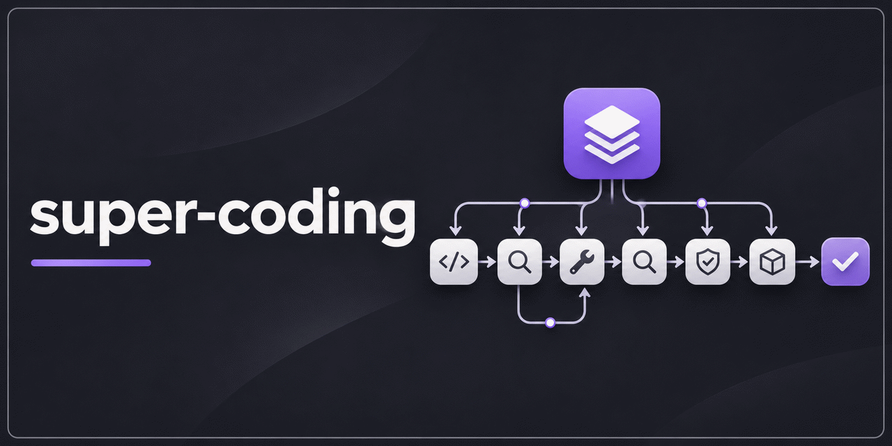
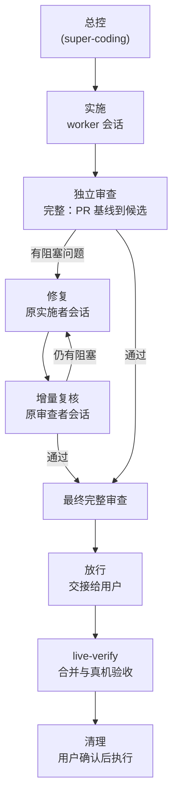

<p align="center">
  
</p>

# super-coding

[English](README.md) | **简体中文**

[](https://github.com/xmxxc/super-coding/actions/workflows/ci.yml)
[](https://github.com/xmxxc/super-coding/releases)
[](LICENSE)

面向编码智能体的多票据开发流程：由一个总控把实施和独立审查派发到 Codex、OpenCode 或 Claude Code 会话，worker 干活时总控睡眠，收到它们的消息再醒来。

## 这是什么

super-coding 是一组智能体技能。你开一个总控会话，告诉它仓库和要做的票，它会把每张票从实施一路推进到放行交接：

- 每个实施者和审查者都在自己的宿主会话里运行，通过 `wfc` 派发。`wfc` 是 [xmxxc/workflow-core](https://github.com/xmxxc/workflow-core) 提供的调度器。
- 修复交回原来的实施者，增量复核交回原来的审查者，所以每一轮只看新的补丁。
- 放行前做一次最终完整审查，真机验收交给 `live-verify`。

适合跨多张票、多个智能体协作的开发：审查要独立于实施者，每一轮都要有书面账本，worker 忙的时候总控在睡眠。

## 工作流程



三种审查（完整审查、增量复核、最终完整审查）的定义、独立性要求和记录格式，见 [references/review.md](skills/super-coding/references/review.md)。

## 特性

- **三种宿主**：实施者和审查者可以跑在 Codex、OpenCode 或 Claude Code 上，总控也可以在这三者中的任何一个里运行。
- **睡眠与唤醒**：在 Claude Code 里，总控在后台挂一个 `wfc wait`；在 Codex 和 OpenCode 里，总控启动一个 `wfc relay`，worker 的消息会作为新的一轮送达。
- **原会话修复**：用 `wfc continue` 把修复交给原实施者、把复核交给原审查者；补丁影响不清，或者改写过历史时，扩大为完整审查。
- **每次唤醒都对账**：处理完消息，总控会把就绪的工作派出去，只有剩下的都是需要用户授权的事（合并、真机验收、生产操作、回收）时才停下。
- **例行检查脚本化**：`scripts/ctl.py` 负责快照检查（记录真实退出码）、回读候选、转录断网审查者的记录、切换生命周期标签。
- **账本、审查与放行规则都在一个技能里**：账本、任务文件、独立审查、验证分层、Issue 标签和放行交接都是 `super-coding` 的 references，到了对应阶段再读。
- **角色表**：各角色用哪个宿主、模型、推理强度、能否联网、备用方案，都写在 `docs/agents/roles.md`。
- **清理由用户决定**：范围完成后，总控把 tmux 会话、worktree、已合并的分支、router 状态目录和端口占用列给用户；用户同意后才用 `wfc reclaim` 关闭会话。

## 前置依赖

| 依赖 | 说明 |
| --- | --- |
| Linux 或 macOS | Windows 请用 WSL2。 |
| Python 3.9+ | 运行 `install.py` 和 `scripts/ctl.py`，只用标准库。 |
| tmux | 每个 worker 都在名为 `wfc-<dispatch id>` 的 tmux 会话里运行。 |
| `wfc` 0.4.4 及以上，放在 `PATH` 上 | 从 [xmxxc/workflow-core](https://github.com/xmxxc/workflow-core) 的 Releases 下载。 |
| `gh` | 处理 GitHub 上的票和 PR。 |
| 宿主 CLI | Claude Code、Codex、OpenCode，按你要派发到的宿主安装。 |

### 来自 mattpocock/skills 的技能

这几个技能运行时会调用或依赖公开仓库 [mattpocock/skills](https://github.com/mattpocock/skills) 里的技能。

| 技能 | 状态 | 用途 |
| --- | --- | --- |
| [`setup-matt-pocock-skills`](https://github.com/mattpocock/skills/tree/main/skills/engineering/setup-matt-pocock-skills) | **已随包附带**：`skills/setup-matt-pocock-skills/` 是一份未经修改的锁定副本，`install.py` 只在你自己没有同名技能时安装它。 | 项目没有初始化（`docs/agents/` 里缺 tracker、标签或领域配置）时，`super-coding` 和 `live-verify` 会先调用它。每个项目先跑一次。 |
| [`code-review`](https://github.com/mattpocock/skills/tree/main/skills/engineering/code-review)、[`implement`](https://github.com/mattpocock/skills/tree/main/skills/engineering/implement)、[`tdd`](https://github.com/mattpocock/skills/tree/main/skills/engineering/tdd) | **推荐，不随包附带**，需要另外安装。 | worker 用到的通用开发技能。任务文件不点名这些技能，而是让执行者按项目已安装的开发工作流选择方法，所以请装好你希望 worker 使用的技能。 |

## 快速开始

1. **安装**：从 [Releases](https://github.com/xmxxc/super-coding/releases) 下载 `super-coding-<version>.tar.gz` 并解压（或者直接克隆本仓库），然后运行：

   ```sh
   python3 install.py
   ```

   它会把 `super-coding` 装进 `~/.claude/skills` 和 `~/.codex/skills`（两者中存在的那个或两个），随包附带的 `live-verify` 和 `setup-matt-pocock-skills` 只在你自己没有同名技能的地方安装。用链接方式做的开发安装不会被改动。早期版本留下、`super-coding` 已不再需要的技能会保留，安装脚本会提示你可以自行移除。另外把 `wfc` 放到 `PATH` 上。

2. **初始化项目**：如果项目的 `docs/agents/` 还没写明 tracker、标签和领域约定，先在项目里运行 `setup-matt-pocock-skills`（第 1 步已装好）。

3. **写角色表**：把 [skills/super-coding/references/roles.md](skills/super-coding/references/roles.md) 里的模板复制到 `docs/agents/roles.md`，按项目修改。表不存在时，总控会先问你，再把你的回答写进这张表。

4. **启动总控**：在宿主里开一个会话，调用 `super-coding`，并告诉它仓库和本次范围内的票。Codex 的总控会话要用 `danger-full-access` 启动；OpenCode 的总控会话要用固定端口启动（`opencode <目录> --port <端口>`）。各宿主的具体命令见 [references/router.md](skills/super-coding/references/router.md)。

## 角色表示例

总控接管时读取 `docs/agents/roles.md`。总控本身不写进表：在哪个会话里调用 `super-coding`，那个会话就是总控。

```markdown
| 角色 | 宿主 | 模型 | 推理强度 | 联网 | 备用宿主 | 备用模型 |
| --- | --- | --- | --- | --- | --- | --- |
| 实施 | codex | gpt-6.1-sol | high | 否 | claude | 默认 |
| 前端实施 | claude | 默认 | 默认 | 是 | codex | 默认 |
| 审查 | codex | gpt-6.1-sol | high | 否 | claude | 默认 |
```

- **宿主**：`wfc dispatch --host` 的取值（`codex`、`opencode`、`claude`）。
- **模型**、**推理强度**：`--model`、`--effort` 的取值；写"默认"就不带这个参数。宿主是 `opencode` 时必须写明模型。
- **联网**：只对 Codex 生效，"是"表示派发时带 `--network`。
- **备用宿主**、**备用模型**：主宿主额度耗尽或认证失败时改派到哪里；写"无"表示交给用户处理。

## 目录结构

```text
.
├── docs/assets/banner.png
├── install.py                    # 安装脚本
├── skills/
│   ├── super-coding/             # 总控技能
│   │   ├── SKILL.md
│   │   ├── references/
│   │   │   ├── router.md         # 派发、等待、continue/resume、消息处理、恢复
│   │   │   ├── roles.md          # 角色表模板
│   │   │   ├── ledger.md         # 账本、任务状态、留痕
│   │   │   ├── handoff.md        # 实施与修复的任务文件
│   │   │   ├── review.md         # 独立审查
│   │   │   ├── verification.md   # 验证分层与测试矩阵
│   │   │   ├── labels.md         # Issue 标签
│   │   │   └── release.md        # 放行交接与收尾
│   │   └── scripts/ctl.py        # 每轮之间的例行检查
│   ├── live-verify/              # 合并与真机验收，在本仓库维护
│   ├── setup-matt-pocock-skills/ # 来自 mattpocock/skills 的第三方锁定副本
│   └── VENDORED.md
└── tests/
    ├── test_ctl.py               # 真实 git，模拟 gh
    └── test_install.py           # 临时 HOME
```

- `skills/super-coding/references/router.md` 讲派发、等待、continue/resume、消息处理和恢复；其余 references 是账本、交接、审查、验证、标签和放行的规则。
- `skills/super-coding/scripts/ctl.py` 是总控每轮之间的例行检查（快照检查并记录真实退出码、回读候选、转录断网审查者的记录、切换生命周期标签）。只用 Python 标准库，另外调用 git 和 gh。技能从自己的目录运行它，所以装好技能就装好了脚本。
- `skills/live-verify/` 从技能仓库分出，之后在本仓库维护；`skills/setup-matt-pocock-skills/` 是来自 mattpocock/skills、未经修改的锁定副本。详见 [skills/VENDORED.md](skills/VENDORED.md)。

## 与 workflow-core 的关系

[xmxxc/workflow-core](https://github.com/xmxxc/workflow-core) 提供 `wfc`，也就是这些技能驱动的调度器（`dispatch`、`continue`、`resume`、`wait`、`relay`、`status`、`reply`、`nudge`、`reclaim`）。本仓库只放技能。两者分开发布：`wfc` 需要单独下载，`super-coding` 要求 `wfc` 0.4.4 及以上。

设计记录（决策、宿主探测、审查历史）放在调度器所在的 xmxxc/workflow-core。

## 开发与发布

运行测试：

```sh
python3 -m unittest discover -s tests
```

CI 在 Ubuntu 和 macOS 上，用 Python 3.9 和 3.12 运行这些测试。

发布时推送标签 `v<version>`。发布流程会先跑测试，再把 `skills/`、`install.py`、`README.md`、`README.zh-CN.md` 和 `LICENSE` 打包成 `super-coding-<version>.tar.gz`，连同它的 SHA-256 一起发布。

## 许可证

[MIT](LICENSE) © xmxxc，适用于 `super-coding`、`live-verify` 以及本仓库的其余内容。

随包附带的 `skills/setup-matt-pocock-skills/` 来自 [mattpocock/skills](https://github.com/mattpocock/skills)，适用 MIT 许可证，版权归 Matt Pocock 所有（Copyright (c) 2026 Matt Pocock）。它的许可证文件和它放在一起；来源提交、校验和与完整的版权声明见 [skills/VENDORED.md](skills/VENDORED.md)。[前置依赖](#来自-mattpocockskills-的技能)里列出的推荐技能不在本仓库中，适用它们各自的许可证。
